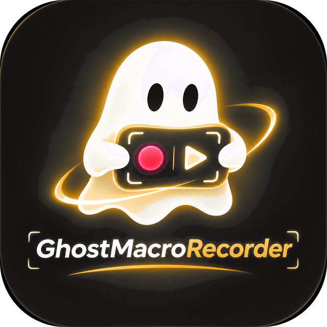
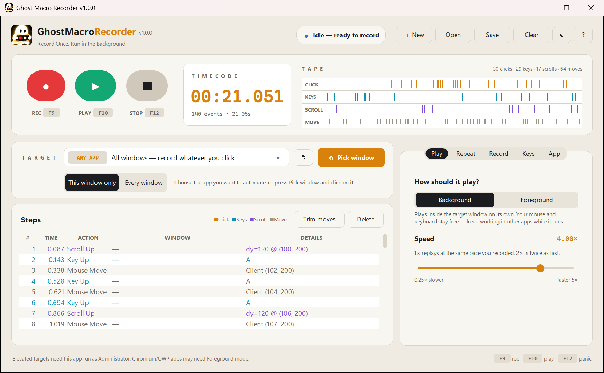

<p align="center">
  
</p>

<h1 align="center">Ghost Macro Recorder</h1>

<p align="center"><b>Record Once. Run in the Background.</b></p>

<p align="center">
  A Windows macro recorder that replays your clicks and keystrokes <i>inside one app window</i> —
  while you keep using your mouse and keyboard for everything else.
</p>

<p align="center">
  <a href="../../releases/latest"><b>⬇ Download for Windows</b></a>
</p>

---

<p align="center">
  
</p>

## Why "Ghost"?

Most macro tools take over your computer while they run: the cursor jumps around, keys get typed into
whatever window is in front, and you have to sit and wait.

Ghost Macro Recorder works like a ghost in the background. It sends the recorded clicks, drags,
scrolls and key presses **directly to the window you picked**, without moving your real mouse or
stealing keyboard focus. Start a macro, then switch to another app and carry on working.

## Features

- **Background playback** — replays input straight into the target window (Win32 messages), so your mouse and keyboard stay free.
- **Foreground mode** — a classic "real mouse & keyboard" mode for apps that ignore background input.
- **Pick any window** — search the list of open windows, or click *Pick window* and switch to your app within 3 seconds.
- **This window only** — only input inside the chosen app is recorded; everything else you do is ignored.
- **Live tape view** — every click, key, scroll and mouse move shows up as a colour-coded tick while recording, with a playhead during playback.
- **Repeat count _or_ run for a set time** — loop a macro N times, forever, or for an exact duration like `1:00`, `90s`, `5m` or `1h`. A live estimate shows how many loops and steps will fit.
- **Speed control** — 0.25× to 5×, plus an adjustable wait between loops.
- **Countdown** before playing (3 s / 5 s) so you have time to switch to your app.
- **Humanize** — adds a small random variation to every pause so replays don't run at robot-perfect intervals.
- **When it's done** — show a Windows notification or play a sound when a long run finishes.
- **Step editor** — review every recorded step, delete selected steps, or trim mouse moves in one click.
- **＋ New, Save & Open** — macros are `.json` files. If you start a new recording, open another file, clear or quit while the current macro has unsaved changes, Ghost asks whether to save it first (the title bar shows • when there are unsaved changes).
- **Global hotkeys** — `F9` record/stop, `F10` play/stop, `F12` stop everything, `Ctrl + Alt + T` target the app you're in. Change any of them by clicking a box and pressing a key or combo. If another program already owns a key, Ghost says so and offers a free one in one click.
- **System tray** — keeps running next to the clock when closed; the tray ghost shows a red dot while recording and a green dot while playing. Opening the app again just brings the existing window back.
- **Start with Windows** (quietly in the tray), **Always on top**, and a one-click **Open macros folder**.
- **Every setting explained in plain words**, and **Light, Dark or System theme.**
- **Scales coordinates** if the target window is resized between recording and playback.

<p align="center">
  
</p>

## Download & install

1. Go to the [**latest release**](../../releases/latest) and download **`GhostMacroRecorder-Setup-x.y.z.exe`**.
2. Run the installer and follow the steps.
3. Launch **Ghost Macro Recorder** from the Start Menu (or the desktop shortcut, if you ticked it).

### Where things are installed

Everything lives on your **C: drive** in the standard Windows locations:

| What | Location |
| --- | --- |
| App and all its libraries | `C:\Program Files\Ghost Macro Recorder\` |
| Your settings | `C:\Users\<you>\AppData\Roaming\GhostMacroRecorder\config.json` |
| Saved macros (default folder) | `C:\Users\<you>\AppData\Roaming\GhostMacroRecorder\macros\` |
| Start Menu shortcut | Start → *Ghost Macro Recorder* |

No Python or anything else needs to be installed separately.

**Uninstall:** Windows *Settings → Apps → Installed apps → Ghost Macro Recorder → Uninstall*.
(Your settings and saved macros in `AppData` are kept, in case you reinstall.)

> [!NOTE]
> The installer isn't code-signed yet, so Windows SmartScreen may show *"Windows protected your PC"*.
> Click **More info → Run anyway**. On PCs with **Smart App Control** turned on, unsigned apps are
> blocked entirely — run it from source instead (see below).

## How to use

1. **Pick a target** — choose the app from the *Target* list (type to search), or press **Pick window** and switch to it.
2. **Record** — press **● REC** (or `F9`) and do your clicks and typing in that window. Press again to stop.
3. **Check the steps** — the tape and the step list show everything captured. Delete or trim anything you don't need.
4. **Choose how long to run** — in *Settings → Repeat*, pick **Repeat count** (`0` = forever) or **Run for time** (e.g. `1:00`).
5. **Play** — press **▶ PLAY** (or `F10`), then go and do something else. `F12` stops everything instantly.

### Tips

- If an app ignores background clicks (some Chromium, UWP or game windows), switch *Settings → Play* to **Foreground**.
- If a hotkey shows *taken by another app* in *Settings → Keys*, click it and pick a different key.
- If the target app runs **as Administrator**, run Ghost Macro Recorder as Administrator too — Windows blocks
  normal apps from sending input to elevated ones.
- Turn on **Record mouse movement** (*Settings → Record*) only when you need hover/drag paths — it makes macros much bigger.

## Privacy

Ghost Macro Recorder runs **100% offline**. It has no network access, analytics or telemetry. It only listens to
input **while you are recording**, skips password fields and Windows security prompts, and only writes macro files
when you save them. See [SECURITY.md](SECURITY.md) for details.

## Run from source

Requires **Windows 10/11** and **Python 3.10+**.

```powershell
git clone <this-repo-url>
cd <repo-folder>
.\install_and_run.bat
```

`install_and_run.bat` creates a `.venv`, installs the dependencies and starts the app. After that, `launch.bat` starts it directly.

## Build the installer yourself

```powershell
winget install JRSoftware.InnoSetup   # one-time
.\build.ps1
```

`build.ps1` regenerates the icons, runs the tests, packages the app with PyInstaller into
`dist\GhostMacroRecorder\`, and builds `dist\GhostMacroRecorder-Setup-1.0.0.exe` with Inno Setup.

Pushing a tag such as `v1.0.0` to GitHub runs the same build in GitHub Actions and attaches the installer to a
new GitHub Release automatically.

## Project layout

```
main.py                  entry point
src/ui.py                interface (tape deck, steps list, settings)
src/recorder.py          input capture
src/player.py            playback engine (repeat / timed runs)
src/win32_backend.py     Win32 background & foreground input
src/hotkeys.py           global hotkeys
src/tray.py              system tray icon
src/models.py            macro & settings data
installer/               Inno Setup installer script
scripts/generate_icon.py builds the app icons from assets/logo_source.png
tests/                   pytest suite
```

## License

[MIT](LICENSE) © 2026 Ghost Macro Recorder
