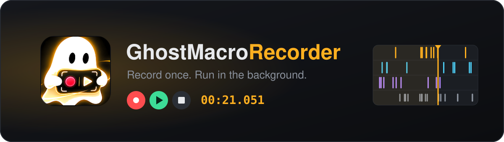
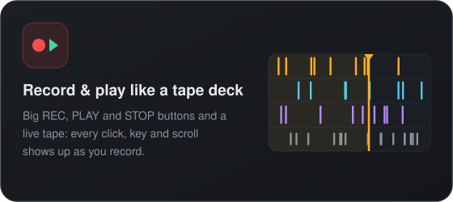
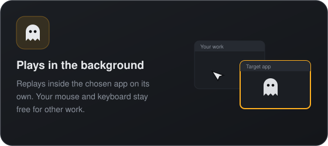
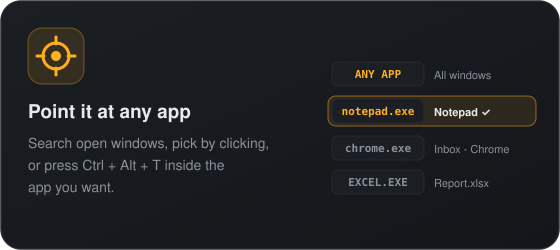
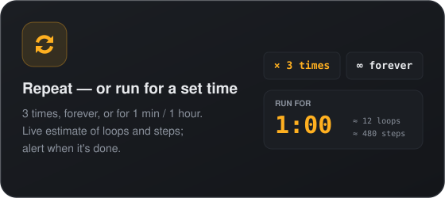
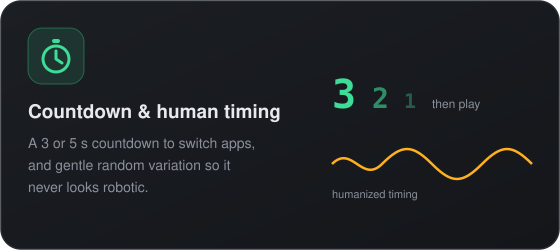
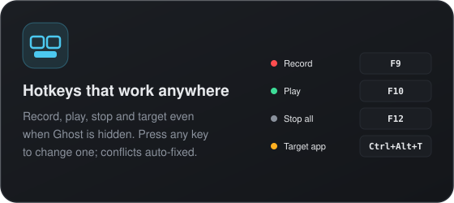
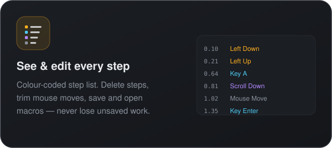
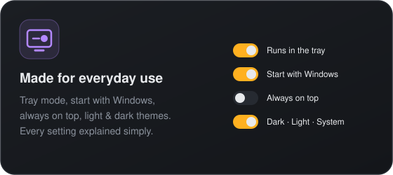
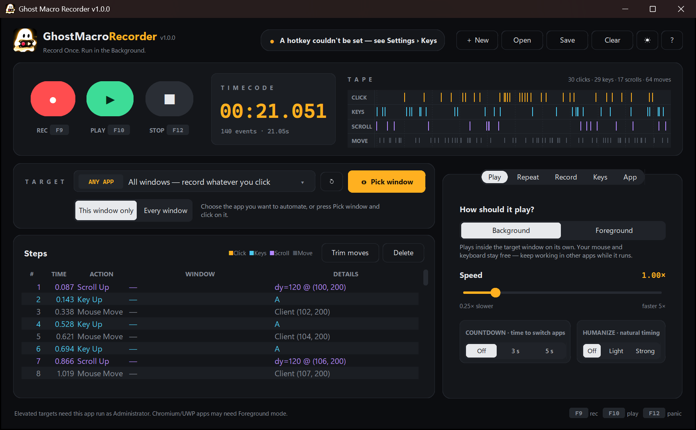

<p align="center">
  
</p>

<p align="center">
  <a href="https://github.com/mohnishkrishna-saikumar-mk9/GhostMacroRecorder/releases/latest/download/GhostMacroRecorder-Setup.exe">
    
  </a>
</p>

<p align="center">
  <a href="https://github.com/mohnishkrishna-saikumar-mk9/GhostMacroRecorder/releases/latest"></a>
  <a href="https://github.com/mohnishkrishna-saikumar-mk9/GhostMacroRecorder/releases"></a>
  
  <a href="https://github.com/mohnishkrishna-saikumar-mk9/GhostMacroRecorder/actions/workflows/release.yml"></a>
  <a href="LICENSE"></a>
  
</p>

<p align="center">
  <a href="#-what-it-can-do"></a>
  <a href="#-download--install"></a>
  <a href="#-how-to-use"></a>
  <a href="#-privacy"></a>
</p>

## 👻 Why "Ghost"?

Most macro tools take over your computer while they run: the cursor jumps around, keys get typed into
whatever window is in front, and you have to sit and wait.

Ghost Macro Recorder works like a ghost in the background. It sends the recorded clicks, drags,
scrolls and key presses **directly to the window you picked**, without moving your real mouse or
stealing keyboard focus. Start a macro, then switch to another app and carry on working.

## ✨ What it can do

<table>
  <tr>
    <td width="50%"></td>
    <td width="50%"></td>
  </tr>
  <tr>
    <td></td>
    <td></td>
  </tr>
  <tr>
    <td></td>
    <td></td>
  </tr>
  <tr>
    <td></td>
    <td></td>
  </tr>
</table>

<details>
  <summary><b>📸 See the actual app</b></summary>
  <br>
  <p align="center"></p>
</details>

## ⬇ Download & install

1. Click **[Download for Windows](https://github.com/mohnishkrishna-saikumar-mk9/GhostMacroRecorder/releases/latest/download/GhostMacroRecorder-Setup.exe)** — it downloads **`GhostMacroRecorder-Setup.exe`** straight away.
   (All versions and release notes: [Releases](../../releases).)
2. Run the installer and follow the steps.
3. Launch **Ghost Macro Recorder** from the Start Menu (or the desktop shortcut, if you ticked it).

### Where things are installed

Everything lives on your **C: drive** in the standard Windows locations:

| What | Location |
| --- | --- |
| App and all its libraries | `C:\Program Files\Ghost Macro Recorder\` |
| Your settings | `C:\Users\<you>\AppData\Roaming\GhostMacroRecorder\config.json` |
| Saved macros (default folder) | `C:\Users\<you>\AppData\Roaming\GhostMacroRecorder\macros\` |
| Start Menu shortcut | Start → *Ghost Macro Recorder* |

No Python or anything else needs to be installed separately.

**Uninstall:** Windows *Settings → Apps → Installed apps → Ghost Macro Recorder → Uninstall*.
(Your settings and saved macros in `AppData` are kept, in case you reinstall.)

> [!NOTE]
> The installer isn't code-signed **yet** — we've applied for free signing from SignPath Foundation
> ([code signing policy](CODE_SIGNING_POLICY.md)). Until then:
> - **SmartScreen** may show *"Windows protected your PC"* → click **More info → Run anyway**.
> - **Smart App Control** blocks unsigned apps completely, with no override. On those PCs,
>   [run it from source](#run-from-source) for now.

## ▶ How to use

1. **Pick a target** — choose the app from the *Target* list (type to search), or press **Pick window** and switch to it.
2. **Record** — press **● REC** (or `F9`) and do your clicks and typing in that window. Press again to stop.
3. **Check the steps** — the tape and the step list show everything captured. Delete or trim anything you don't need.
4. **Choose how long to run** — in *Settings → Repeat*, pick **Repeat count** (`0` = forever) or **Run for time** (e.g. `1:00`).
5. **Play** — press **▶ PLAY** (or `F10`), then go and do something else. `F12` stops everything instantly.

### Tips

- If an app ignores background clicks (some Chromium, UWP or game windows), switch *Settings → Play* to **Foreground**.
- If a hotkey shows *taken by another app* in *Settings → Keys*, click the warning to switch to a free key.
- If the target app runs **as Administrator**, run Ghost Macro Recorder as Administrator too — Windows blocks
  normal apps from sending input to elevated ones.
- Turn on **Record mouse movement** (*Settings → Record*) only when you need hover/drag paths — it makes macros much bigger.

## 🔒 Privacy

Ghost Macro Recorder runs **100% offline**. It has no network access, analytics or telemetry. It only listens to
input **while you are recording**, skips password fields and Windows security prompts, and only writes macro files
when you save them. See [SECURITY.md](SECURITY.md) for details.

## Run from source

Requires **Windows 10/11** and **Python 3.10+**.

```powershell
git clone <this-repo-url>
cd <repo-folder>
.\install_and_run.bat
```

`install_and_run.bat` creates a `.venv`, installs the dependencies and starts the app. After that, `launch.bat` starts it directly.

## Build the installer yourself

```powershell
winget install JRSoftware.InnoSetup   # one-time
.\build.ps1
```

`build.ps1` regenerates the icons, runs the tests, packages the app with PyInstaller into
`dist\GhostMacroRecorder\`, and builds `dist\GhostMacroRecorder-Setup.exe` with Inno Setup.

Pushing a tag such as `v1.0.0` to GitHub runs the same build in GitHub Actions and attaches the installer to a
new GitHub Release automatically.

## Project layout

```
main.py                  entry point
src/ui.py                interface (tape deck, steps list, settings)
src/recorder.py          input capture
src/player.py            playback engine (repeat / timed runs)
src/win32_backend.py     Win32 background & foreground input
src/hotkeys.py           global hotkeys
src/tray.py              system tray icon
src/icons.py             crisp per-DPI window & tray icons
src/autostart.py         start with Windows
src/single_instance.py   one running copy at a time
src/models.py            macro & settings data
installer/               Inno Setup installer script
scripts/generate_icon.py builds the app icons from assets/logo_source.png
scripts/make_readme_art.py draws the README banner and feature cards
tests/                   pytest suite
```

## Code signing, conduct and license

- [Code signing policy](CODE_SIGNING_POLICY.md) — what is signed, how releases are built, team roles and privacy.
- [Code of conduct](CODE_OF_CONDUCT.md)
- [MIT](LICENSE) © 2026 Ghost Macro Recorder
